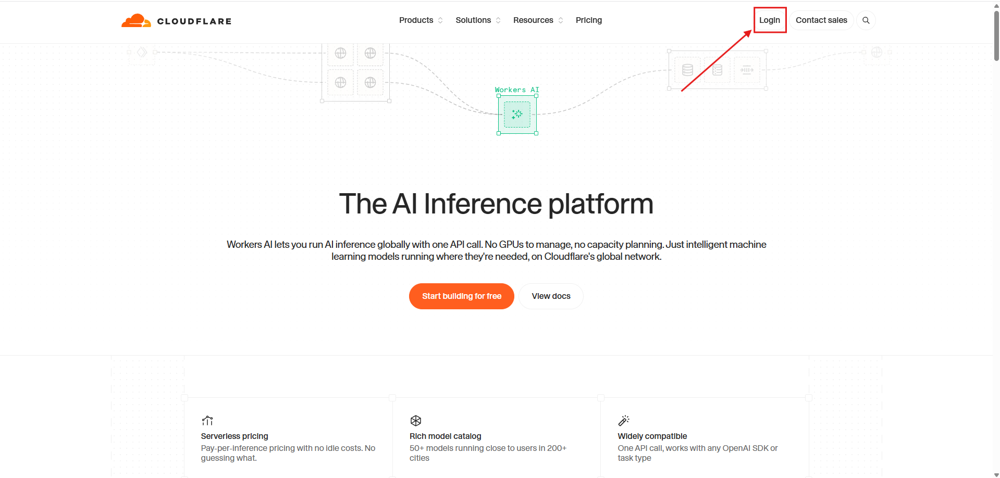
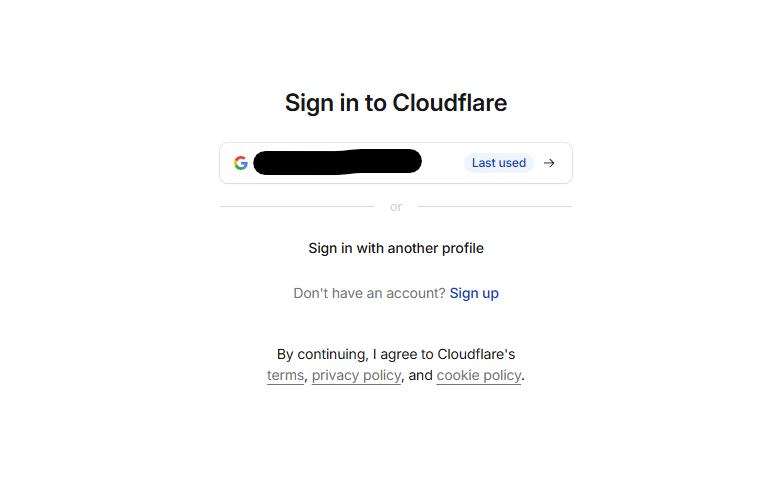
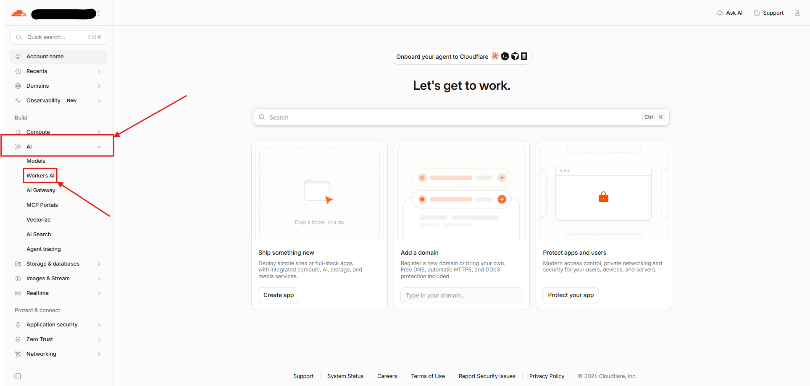
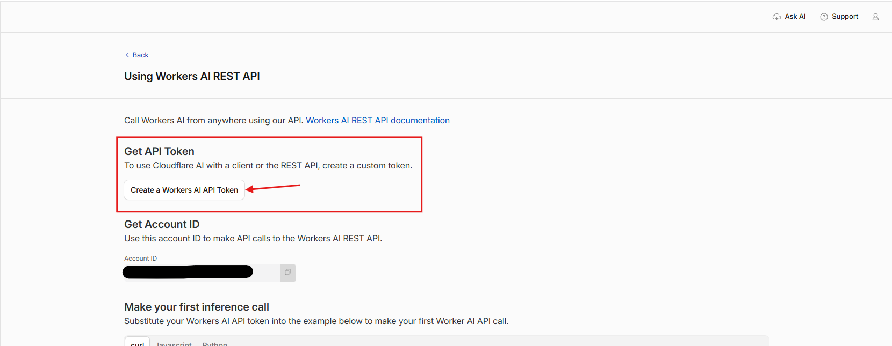
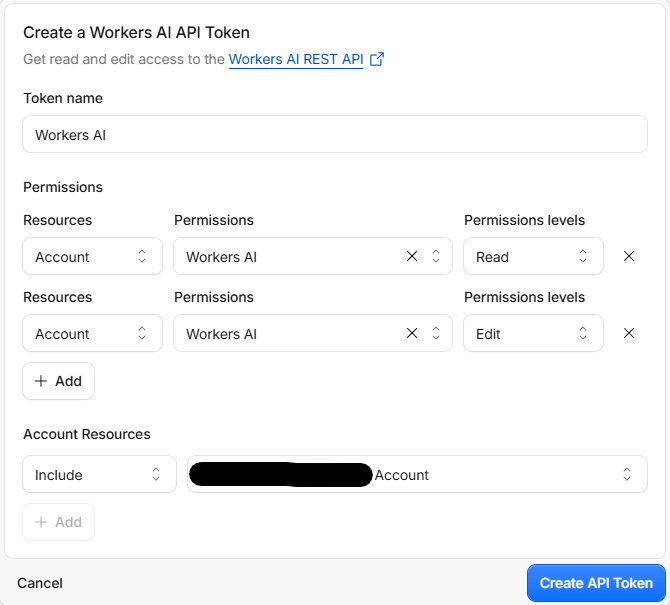
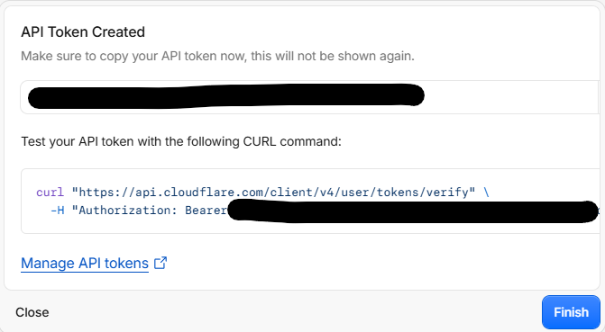

# Cómo conseguir el API token de Cloudflare (modo Imágenes)

Para generar imágenes con FLUX.1 schnell necesitas una cuenta gratuita de
Cloudflare y un API token con permisos de Workers AI (10.000 Neurons/día
gratis). Solo tardas unos minutos.

## 1. Entra en Cloudflare y pulsa «Log in»

## 2. Inicia sesión (o crea una cuenta gratis)

Si no tienes cuenta, usa «Sign up». Es gratis.

## 3. En el panel, ve a AI → Workers AI

## 4. Pulsa «Create a Workers AI API Token»

## 5. Revisa los permisos y crea el token

Viene prerrellenado con lo necesario: `Workers AI` en lectura y edición
sobre tu cuenta. Pulsa «Create API Token».

## 6. Copia el token AHORA (solo se muestra una vez)

Importante:

- Pulsa el botón de copiar del diálogo. El token completo solo aparece aquí.
- No copies el valor recortado de la lista de tokens (el que se ve como
  `cfat…0ce8`): ese no funciona y da error 401.
- Guarda el token en un sitio seguro. Si lo pegas en un chat o una captura,
  elimínalo en el panel y crea otro.

## 7. Pégalo en RBLX Forge

1. Abre la app → Configuración → Imágenes.
2. Pega el **Account ID** (el de la página del paso 4, junto al botón de copiar)
   y el **API token** completo.
3. Pulsa «Guardar credenciales» y luego **«Probar conexión»** (no gasta Neurons).
4. Si dice «Token válido y activo», ya puedes generar en el módulo Imágenes.

## Si algo falla

| Mensaje | Qué hacer |
|---|---|
| `Invalid API Token` (401) | El valor pegado no coincide con ningún token: recópialo entero del diálogo de creación o crea uno nuevo. |
| La app avisa de token corto o con pinta de Account ID | Revisa que no hayas intercambiado los campos ni pegado el valor recortado. |
| Error de red/timeout | Comprueba tu conexión y que el firewall permite a la app salir a `api.cloudflare.com`. |
